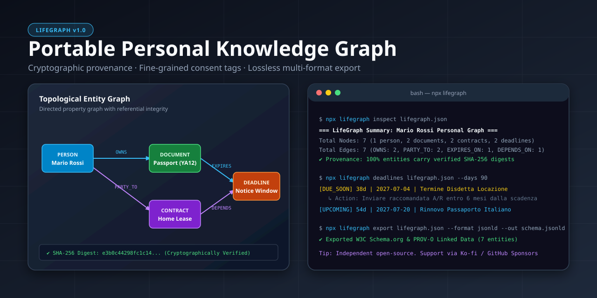

# LifeGraph — Modello Dati a Grafo Personale Portabile

[Italiano](README.it.md) • [English](README.md) • [Architettura](docs/ARCHITECTURE.md) • [Lancio & SEO](docs/LAUNCH.md)

[](LICENSE)
[](https://github.com/MRJonam91/LifeGraph/actions/workflows/ci.yml)
[](package.json)
[](package.json)
[](https://github.com/sponsors/MRJonam91)

Modello dati e grafo deterministico per dati personali: connette persone, documenti, contratti e scadenze con provenienza crittografica, gestione granulare dei consensi ed esportazione senza perdita di dati.

<p align="center">
  
</p>

---

## 💥 Il Problema

Documenti d'identità, contratti d'affitto, utenze luce/gas e scadenze burocratiche sono frammentati tra email, faldoni cartacei, portali bancari e silos proprietari:
- **Assenza di Topologia di Relazione**: Un contratto di locazione è collegato a un inquilino (persona), a documenti d'identità (CIE/passaporto), a un termine di disdetta e a bollette energetiche, ma non esiste uno standard aperto per connetterli senza vincoli proprietari.
- **Dichiarazioni di Dati Non Verificabili**: I record digitali e gli input per agenti AI mancano di prove crittografiche di integrità e tracciamento della provenienza.
- **Diffusione Incontrollata dei Dati Personali**: Condividere documenti per una pratica di mutuo o per una locazione finisce per esporre dati non pertinenti a causa dell'assenza di filtri per finalità di consenso (purpose limitation).
- **Scadenze e Termini Dimenticati**: Finestre di recesso per locazioni, rinnovi di passaporto e disdette di contratti scadono inosservate, causando rinnovi taciti e spese impreviste.

---

## 💡 La Soluzione: LifeGraph

LifeGraph modella la propria amministrazione personale come un **Grafo Orientato a Proprietà** (`lifegraph.json`):
- **Entità Deterministiche Tipizzate**: Modelli per **Persone**, **Documenti**, **Contratti** e **Scadenze**, collegati da relazioni orientate (`OWNS`, `PARTY_TO`, `ATTACHED_TO`, `EXPIRES_ON`, `DEPENDS_ON`).
- **Provenienza Crittografica & Rilevamento Manomissioni**: Ogni nodo e arco possiede un digest deterministico SHA-256 e la fonte di generazione (`user_input`, `verified_issuer`, `file_import`, `agent_inferred`). Qualsiasi manomissione senza ricalcolo viene immediatamente segnalata.
- **Filtri di Consenso Granulari & Finalità GDPR**: Proietta ed esporta solo i sottografi autorizzati per una specifica finalità (es. `--consent banking_kyc` o `--consent rental_application`), garantendo la massima riservatezza.
- **Motore di Calcolo Scadenze**: Valuta automaticamente i termini di disdetta contrattuale (`endDate - noticePeriodDays`) e le scadenze documentali con avvisi a terminale e giorni rimanenti.
- **Diff Determinostico dei Grafi**: Rileva aggiunte, cancellazioni e modifiche di proprietà tra versioni successive del ledger.
- **Esportazione Multiformato Senza Perdita**:
  - **JSON Canonico**: Serializzazione ordinata e deterministica con ri-importazione priva di discrepanze.
  - **W3C JSON-LD**: Linked Data conforme alle ontologie Schema.org e W3C PROV-O.
  - **Markdown Interattivo**: Report riassuntivo con diagramma Mermaid integrato per visualizzare le relazioni.
  - **RFC 5545 iCalendar (`.ics`)**: Feed di calendario con notifiche e allarmi di promemoria.
  - **Dashboard HTML Standalone**: Report visuale moderno e reattivo funzionante al 100% offline senza CDN esterne.
  - **Tabelle CSV**: Esportazione di nodi, archi e scadenze per fogli di calcolo.

---

## 🚀 Avvio rapido​‌​​‌‌​‌​‌​‌​​‌​​‌​​‌​‌​​​‌‌‌​​‌​​‌‌​​​‌​​‌​‌‌​‌​‌‌​‌‌​​​‌‌​​‌‌‌​​‌​‌‌​‌​‌‌​​‌​​​​‌‌​‌​​​‌‌​​‌​‌​​‌‌‌​​​​‌‌​​​‌‌​​‌‌​​​‌

```bash
# 1. Inizializza un ledger vuoto o genera un grafo di esempio
npx lifegraph init mio-grafo.json
npx lifegraph sample esempio.json

# 2. Ispeziona entità, statistiche e relazioni
npx lifegraph inspect esempio.json

# 3. Consulta le scadenze nei prossimi 90 giorni
npx lifegraph deadlines esempio.json --days 90

# 4. Verifica l'integrità crittografica e la coerenza referenziale
npx lifegraph validate esempio.json

# 5. Esporta in Markdown con diagramma Mermaid o calendario RFC 5545 (.ics)
npx lifegraph export esempio.json --format markdown --out report.md
npx lifegraph export esempio.json --format ics --out scadenze.ics
```

---

## 🛠️ Riferimento Comandi CLI

```text
USO:
  lifegraph <comando> [opzioni]

COMANDI:
  init [file]                    Inizializza un file LifeGraph vuoto (default: lifegraph.json)
  sample [file]                  Genera un dataset sintetico dimostrativo
  validate <file>                Valida schema, integrità referenziale e digest crittografici
  inspect <file>                 Mostra riepilogo dettagliato e statistiche entità
  stats <file>                   Alias di 'inspect'
  deadlines <file> [--days N]    Elenca scadenze imminenti e scadute (default: 60 giorni)
  query <file> [opzioni]         Cerca entità per tipo, tag o parola chiave
  filter <file> --consent <p>    Esporta un sottografo ristretto al consenso indicato
  anonymize <file> [--out <f>]   Anonimizza i PII preservando la topologia delle relazioni
  export <file> --format <fmt>   Esporta in formato json, jsonld, markdown, ics, html o csv
  diff <fileA> <fileB>           Confronta due file snapshot di LifeGraph
  sponsor                        Mostra i canali di donazione e supporto

OPZIONI:
  -f, --format <fmt>             Formato di esportazione: json | jsonld | markdown | ics | html | csv
  -o, --out <path>               Scrive l'output su file anziché su stdout
  -c, --consent <purpose>        Filtro finalità di consenso (es. general_admin, tax_filing, banking_kyc)
  -t, --type <type>              Filtra per tipo di entità: person | document | contract | deadline
  -s, --search <keyword>         Stringa di ricerca
  -d, --days <number>            Giorni di anticipo per le scadenze (default: 60)
  --all                          Includi scadenze completate o archiviate
  --no-digests                   Ignora la verifica dei digest SHA-256
  -v, --version                  Mostra la versione
  -h, --help                     Mostra questo messaggio di aiuto
```

---

## 📐 Architettura ed Estendibilità

LifeGraph è progettato con **zero dipendenze di runtime esterne** su Node.js moderno (`>= 22.18`), con tipizzazione rigorosa e un core inferiore alle **1.500 righe di codice** per garantire audit immediato:

```text
src/
├── core/
│   ├── constants.ts        # Namespace, nonce, vocabolario predicati, URL sponsor
│   ├── types.ts            # Schema tipizzato per nodi, archi, provenienza, consensi
│   ├── crypto.ts           # Serializzazione JSON canonica e digest SHA-256
│   ├── graph.ts            # Gestione grafo a proprietà, interrogazione e proiezioni
│   ├── validator.ts        # Validazione schema, integrità referenziale e digest
│   ├── deadlines.ts        # Calcolo stati scadenze e sintesi da contratti/documenti
│   ├── diff.ts             # Confronto deterministico snapshot
│   └── stats.ts            # Metriche aggregate del grafo
├── exporters/
│   ├── canonical-json.ts   # Serializzatore deterministico senza perdita
│   ├── jsonld.ts           # Linked Data W3C Schema.org & PROV-O
│   ├── markdown.ts         # Report Markdown con grafo Mermaid integrato
│   ├── ical.ts             # Calendario RFC 5545 (.ics) con allarmi
│   ├── html.ts             # Dashboard visuale offline standalone
│   └── csv.ts              # Esportazioni tabellari (nodi, archi, scadenze)
├── sample.ts               # Scenario sintetico privacy-safe di pratiche personali
├── cli/
│   └── index.ts            # Interfaccia a riga di comando a zero dipendenze
└── index.ts                # API pubblica della libreria
```

Le specifiche dettagliate sono disponibili in [docs/ARCHITECTURE.md](docs/ARCHITECTURE.md).

---

## 💖 Supporto e Donazioni

LifeGraph è un progetto open-source indipendente sviluppato a supporto della sovranità digitale individuale. Se ti è utile per gestire contratti e scadenze, puoi sostenere lo sviluppo continuo:

- **GitHub Sponsors**: [github.com/sponsors/MRJonam91](https://github.com/sponsors/MRJonam91)
- **Ko-fi**: [ko-fi.com/mrjonam](https://ko-fi.com/mrjonam)
- **Buy Me a Coffee**: [buymeacoffee.com/mrjonam](https://buymeacoffee.com/mrjonam)
- **PayPal**: [paypal.me/manorollo](https://paypal.me/manorollo)

---

## 📜 Licenza e Attribuzione

Questo progetto è rilasciato sotto la licenza **Apache License, Version 2.0**.
Consulta [LICENSE](LICENSE) e [NOTICE](NOTICE) per i termini completi. La documentazione è distribuita con licenza [CC BY-SA 4.0](LICENSING.md).
