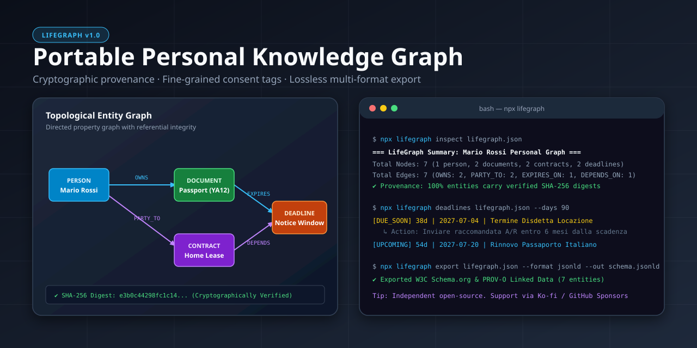

# LifeGraph — Portable Personal Knowledge & Entity Graph

[Italiano](README.it.md) • [English](README.md) • [Architecture](docs/ARCHITECTURE.md) • [Launch & SEO](docs/LAUNCH.md)

[](LICENSE)
[](https://github.com/MRJonam91/LifeGraph/actions/workflows/ci.yml)
[](package.json)
[](package.json)
[](https://github.com/sponsors/MRJonam91)

Deterministic personal knowledge and entity graph: connect persons, documents, contracts, and deadlines with cryptographic provenance, fine-grained consent tags, local-first vault sealing, and lossless export.

<p align="center">
  
</p>

---

## 💥 The Problem

Personal paperwork, contracts, identity documents, and legal deadlines are scattered across emails, paper folders, banking portals, and proprietary cloud silos:
- **Missing Relationship Topology**: A lease contract links to a tenant (person), an identity document (CIE/passport), a renewal notice deadline, and an energy utility, but today there is no portable open standard to link them together without lock-in.
- **Unverifiable Data Claims**: Digital records and AI agent inputs lack cryptographic tamper-evidence and lineage tracking.
- **Uncontrolled Consent Sprawl**: Sharing paperwork for a mortgage application or rental contract often exposes unrelated personal data due to the lack of purpose-scoped filtering.
- **Forgotten Deadlines & Hidden Costs**: Rental notice cutoffs, passport expiries, and utility cancellation deadlines slip past unnoticed, causing automatic renewals, costly penalties, and unchecked recurring burn.

---

## 💡 The Solution: LifeGraph

LifeGraph models your personal administration as a deterministic, portable **Directed Property Graph** (`lifegraph.json`):
- **Deterministic Entity Primitives**: Strongly typed models for **Persons**, **Documents**, **Contracts**, and **Deadlines**, interconnected by directed typed relationships (`OWNS`, `PARTY_TO`, `ATTACHED_TO`, `EXPIRES_ON`, `DEPENDS_ON`).
- **Cryptographic Provenance & Tamper-Evidence**: Every node and edge carries a deterministic SHA-256 digest and source lineage (`user_input`, `verified_issuer`, `file_import`, `agent_inferred`). Modifying any claim without recalculation immediately flags verification failure.
- **Fine-Grained Consent Tagging & Purpose Limitation**: Project and export only the subgraphs permitted for specific operations (e.g. `--consent banking_kyc` or `--consent rental_application`), ensuring strict GDPR compliance.
- **Privacy Hygiene & Paperwork Auditor**: Evaluates overall health scores (0–100%) and identifies public PII leaks, orphan paperwork, and unprotected document/contract expirations.
- **Relational Lineage & Cycle Detection**: Traverses upstream prerequisites and downstream consequences (`lifegraph trace`), discovering connected components and cyclical dependencies.
- **Deterministic Reconciliation & Ledger Merging**: Merges independent graph snapshots with selectable conflict strategies (`prefer-newer`, `prefer-incoming`, `prefer-base`).
- **Local-First AES-256-GCM Vault Sealing**: Encrypts sensitive personal ledgers with PBKDF2 (100,000 iterations, SHA-256) and authenticated AES-GCM ciphers (`lifegraph seal` / `lifegraph unseal`).
- **Financial Analytics & Recurring Burn Forecast**: Normalizes contract billing frequencies to calculate monthly burn rates and annual fixed commitments (`lifegraph costs`).
- **Universal Data Ingestion**: Ingests vCard contacts, recurring subscription CSV files, and iCalendar events into native graph nodes.
- **Lossless Multi-Format Bi-Directional Export**:
  - **Canonical JSON**: Sorted, deterministic round-trip serialization.
  - **W3C JSON-LD**: Linked Data mapped to Schema.org and W3C PROV-O ontology.
  - **Interactive Markdown**: Complete dossier with an embedded Mermaid diagram of entity relationships.
  - **RFC 5545 iCalendar (`.ics`)**: Native calendar feeds with customizable reminder alarms.
  - **Standalone HTML Dashboard**: Responsive, zero-CDN offline visual report with instant live filtering.
  - **Graphviz DOT (`.dot`)**: Clean color-coded graphs for visual rendering.
  - **Tabular CSV**: Export nodes, edges, and deadlines to spreadsheets.

---

## 🚀 Quick start​‌​​‌‌​‌​‌​‌​​‌​​‌​​‌​‌​​​‌‌‌​​‌​​‌‌​​​‌​​‌​‌‌​‌​‌‌​‌‌​​​‌‌​​‌‌‌​​‌​‌‌​‌​‌‌​​‌​​​​‌‌​‌​​​‌‌​​‌​‌​​‌‌‌​​​​‌‌​​​‌‌​​‌‌​​​‌

```bash
# 1. Initialize an empty personal ledger or generate a demonstration sample
npx lifegraph init my-ledger.json
npx lifegraph sample sample-ledger.json

# 2. Inspect topological entities and relationship stats
npx lifegraph inspect sample-ledger.json

# 3. Run paperwork hygiene & privacy audit
npx lifegraph audit sample-ledger.json

# 4. Check monthly recurring burn rate & annual commitments
npx lifegraph costs sample-ledger.json

# 5. Check upcoming deadlines within the next 90 days
npx lifegraph deadlines sample-ledger.json --days 90

# 6. Trace relational lineage for a specific contract or document
npx lifegraph trace sample-ledger.json ctr-rent-home

# 7. Seal vault with AES-256-GCM encryption for safe cloud backup
npx lifegraph seal sample-ledger.json --pass "MySecretPassphrase!"

# 8. Export to interactive Markdown with Mermaid graph or RFC 5545 iCalendar
npx lifegraph export sample-ledger.json --format markdown --out report.md
npx lifegraph export sample-ledger.json --format ics --out deadlines.ics
```

---

## 🛠️ CLI Reference

```text
USAGE:
  lifegraph <command> [options]

COMMANDS:
  init [file]                    Initialize an empty LifeGraph file (default: lifegraph.json)
  sample [file]                  Generate a synthetic demonstration LifeGraph file
  validate <file>                Validate schema, referential integrity, and cryptographic digests
  inspect <file>                 Show detailed summary and entity statistics
  stats <file>                   Alias for 'inspect'
  audit <file>                   Run privacy hygiene & paperwork completeness audit
  costs <file>                   Calculate recurring burn rate & annual contract commitments
  trace <file> <nodeId>          Trace upstream and downstream dependency lineage
  deadlines <file> [--days N]    List impending and overdue deadlines (default: 60 days)
  query <file> [options]         Search entities by type, tag, or label keyword
  filter <file> --consent <p>    Export a consent-restricted subgraph
  anonymize <file> [--out <f>]   Sanitize PII while preserving relational topology
  merge <fileA> <fileB>          Reconcile & merge two LifeGraph ledgers
  seal <file> --pass <pass>      Encrypt vault with AES-256-GCM local-first security
  unseal <file> --pass <pass>    Decrypt sealed vault file
  import <file> --format <fmt>   Import external records (vcard | csv | ics)
  export <file> --format <fmt>   Export to json, jsonld, markdown, ics, html, csv, or dot
  diff <fileA> <fileB>           Compare two LifeGraph snapshot files
  sponsor                        Show sponsorship and donation channels

OPTIONS:
  -f, --format <fmt>             Target export or import format: json | jsonld | markdown | ics | html | csv | dot | vcard
  -o, --out <path>               Write output to file instead of stdout
  -c, --consent <purpose>        Consent purpose filter (e.g. general_admin, tax_filing, banking_kyc)
  -t, --type <type>              Filter query by entity type: person | document | contract | deadline
  -s, --search <keyword>         Search query string
  -d, --days <number>            Lookahead days for deadlines (default: 60)
  -p, --pass, --passphrase <pwd> Passphrase for sealing / unsealing vault
  --strategy <strategy>          Merge conflict strategy: prefer-newer | prefer-incoming | prefer-base
  --into <targetLedger>          Target LifeGraph file to merge imported entities into
  --strict                       Exit with code 1 if audit warnings/critical issues exist
  --all                          Include completed/dismissed deadlines
  --no-digests                   Skip SHA-256 digest recalculation during validation
  -v, --version                  Print version
  -h, --help                     Print this help message
```

---

## 📐 Architecture & Extensibility

LifeGraph is built with **zero runtime external dependencies** on modern Node.js (`>= 22.18`), with strict type-safety and a core under **1,500 lines of code** for immediate verifiability and auditability:

```text
src/
├── core/
│   ├── constants.ts        # Namespaces, nonces, predicate vocabulary, sponsor URLs
│   ├── types.ts            # Strongly typed schema for nodes, edges, provenance, permissions
│   ├── crypto.ts           # Canonical JSON serialization & SHA-256 digest computation
│   ├── graph.ts            # Directed property graph store, lineage tracing & cycle detector
│   ├── validator.ts        # Schema, referential integrity & digest verification
│   ├── deadlines.ts        # Status calculation & deadline synthesis
│   ├── diff.ts             # Deterministic snapshot comparison
│   ├── stats.ts            # Aggregate graph metrics
│   ├── audit.ts            # Privacy & paperwork health audit engine
│   └── merge.ts            # Deterministic ledger reconciliation
├── security/
│   └── vault.ts            # AES-256-GCM authenticated vault sealing & unsealing
├── analytics/
│   └── costs.ts            # Financial commitments & recurring burn rate calculation
├── adapters/
│   ├── vcard.ts            # vCard 3.0 contact list ingestion
│   ├── subscriptions-csv.ts# Bank / subscriptions CSV ingestion
│   └── ical-import.ts      # RFC 5545 calendar event ingestion
├── exporters/
│   ├── canonical-json.ts   # Lossless round-trip serializer
│   ├── jsonld.ts           # W3C Schema.org & PROV-O Linked Data
│   ├── markdown.ts         # Markdown report with Mermaid graph
│   ├── ical.ts             # RFC 5545 iCalendar (.ics) with alarms
│   ├── html.ts             # Standalone offline visual dashboard with live search
│   ├── dot.ts              # Graphviz (.dot) export
│   └── csv.ts              # Tabular exports (nodes, edges, deadlines)
├── sample.ts               # Privacy-safe synthetic Italian paperwork scenario
├── cli/
│   └── index.ts            # Zero-dependency command-line interface
└── index.ts                # Public programmatic library API
```

Detailed specifications can be found in [docs/ARCHITECTURE.md](docs/ARCHITECTURE.md).

---

## 💖 Support & Donations

LifeGraph is free, independent, open-source software built for individual data sovereignty. If it saves you time or prevents missed deadlines, consider supporting ongoing development:

- **GitHub Sponsors**: [github.com/sponsors/MRJonam91](https://github.com/sponsors/MRJonam91)
- **Ko-fi**: [ko-fi.com/mrjonam](https://ko-fi.com/mrjonam)
- **Buy Me a Coffee**: [buymeacoffee.com/mrjonam](https://buymeacoffee.com/mrjonam)
- **PayPal**: [paypal.me/manorollo](https://paypal.me/manorollo)

---

## 📜 License & Attribution

This project is licensed under the **Apache License, Version 2.0**.
See [LICENSE](LICENSE) and [NOTICE](NOTICE) for complete terms. Documentation is released under [CC BY-SA 4.0](LICENSING.md).
